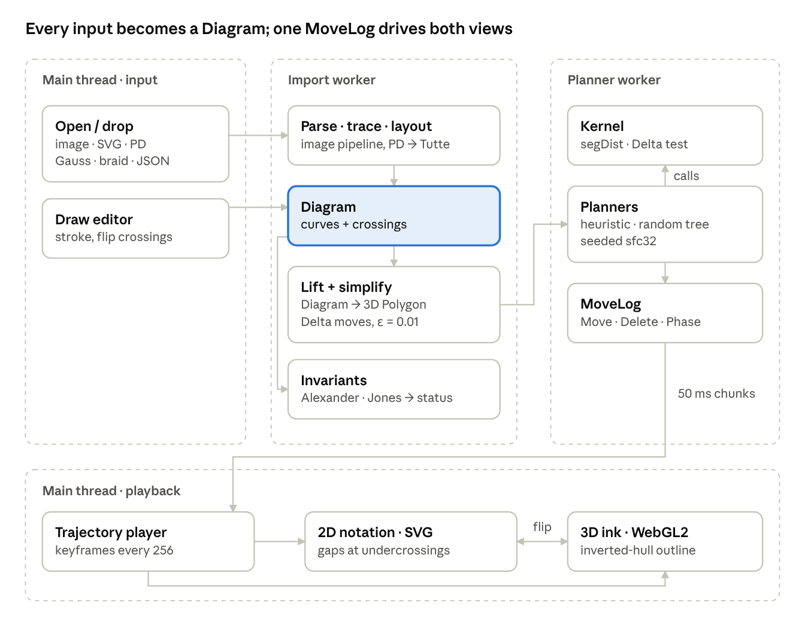
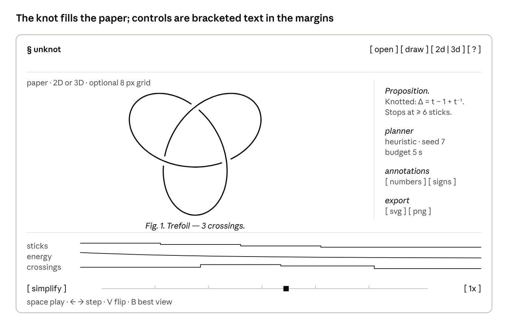

# Unknot Web — Implementation Spec

Oct 14, 2026 · @Zachary Kingston

## Overview

Unknot Web is one static page: draw or import a knot diagram, watch a motion planner untangle it to a triangle, and flip between a 2D knot-notation view and a 3D ink view. It ports [zkingston/unknot](https://github.com/zkingston/unknot) (C++17, \~1.2k LOC, commit `a585ece`, 2025-03-30) to the browser and adds diagram input, which the repo lacks.

The planner is the one from Ladd & Kavraki, "Using Motion Planning for Knot Untangling" (IJRR 2004): a closed polygon in R³ is simplified by vertex removals (`elm`), straight-line vertex moves (`lip`), and repulsive-energy relaxation (`opt`), never letting segments touch.

**Goals**

1. Ship as static files only (no server), deployable to GitHub Pages.
2. Accept knots as 2D diagrams: freehand drawing, image/SVG of a diagram, text codes. 3D JSON stays as a legacy input.
3. Show one knot two ways: 2D knot notation (gaps at undercrossings) and 3D ink rendering (white tube, black outline), with an animated flip between them.
4. Make every animated transition an isotopy: no frame-to-frame interpolation may pass a strand through another.
5. Make runs reproducible: the same knot, planner, parameters and seed give a byte-identical trajectory.

**Non-goals for v1**

- Untangling non-split links (they can be displayed; see Decisions).
- Proving a knot is knotted. Planner success proves unknottedness; failure proves nothing.
- Accounts, server storage, or collaboration. State lives in the URL and `localStorage`.
- Phone-first editing. Viewing must work at 360 px width; drawing is tuned for mouse, pen and trackpad.

**Source repo map** (what the port replaces)

| File | Contents | Fate |
| --- | --- | --- |
| `src/knot.hh` | `PolyLine`: segment distance, `clearance`, `energy`, `elm`, `lip`, `opt` | Ported, with fixes (Geometry kernel) |
| `src/plan.hh` | `Heuristic` and `RandomTree` planners, 5 s time budget | Ported to emit a move log |
| `src/unknot.cc` | CLI: `-f -o -s -p -v` | Replaced by UI |
| `src/visualize.hh` | ImGui + ImPlot3D viewer | Replaced by 2D and 3D views |
| `resources/*.json` | Goeritz (26 verts), Ochiai (61), Thistlethwaite (96) | Bundled as presets |

## Decisions

The first five rows were chosen by the owner. The rest are defaults; the agent follows them unless this table is edited.

| Topic | Decision | Source |
| --- | --- | --- |
| Engine | Port planner and geometry to TypeScript. No Emscripten. Keep the hot kernel behind one interface so WASM or WebGPU can replace it after profiling. | Owner |
| v1 inputs | Draw editor, image + SVG import, PD / Gauss codes, braid words. 3D JSON kept as legacy import. DT codes and table names (e.g. `8_19`) deferred. | Owner |
| 3D rendering | Hand-rolled WebGL2, no 3D library. WebGPU is not used in v1. | Owner |
| Visual style | An old math textbook drawn with a technical pen: one ink on paper, hairline rules, numbered italic figure captions, italic statement lead-ins, bracketed text controls, optional faint grid. | Owner |
| Font | [Iosevka](https://typeof.net/Iosevka/) Term Slab v34.9.0 (SIL OFL 1.1), self-hosted WOFF2 subsets: Regular, Italic, Bold. | Owner |
| Paper colour | Warm off-white `#FBF8F1` instead of pure white, for the textbook look. Revert to `#FFFFFF` if the owner prefers. | Default |
| Location | New `web/` directory in `zkingston/unknot`. The C++ CLI stays untouched. | Default |
| Deploy | Write `.github/workflows/pages.yml` (build `web/`, publish `web/dist` to Pages on push to `main`). The agent does not push; the owner enables Pages and checks the first deploy. | Default |
| Build | Vite + TypeScript (`strict`). Output only `dist/index.html`, self-contained: JS, CSS, workers (`?worker&inline`), fonts and presets inlined via `vite-plugin-singlefile`. Target ≤ 400 KB gzipped. | Default |
| Runtime deps | Zero. Dev deps limited to `vite`, `vite-plugin-singlefile`, `typescript`, `vitest`, `@playwright/test`. Font subsetting uses Python `fonttools` once, outside npm; commit its output. Ask before adding anything else. | Default |
| Browsers | Current and previous major of Chrome, Edge, Firefox, Safari 17+. WebGL2 required for 3D; without it, show a plain-text notice and keep 2D. | Default |
| Links | Several components display fine. Split links (no crossings between components) are planned together as one Scene: each component's moves treat the other components' edges as obstacles. Non-split links: planner disabled with a one-line notice. | Default |
| Planner default | Heuristic planner, 5 s budget (as in the repo), seed shown and editable. Random-tree planner selectable. | Default |
| State | URL hash holds knot, planner, seed, view. `localStorage` only remembers pen size, grid and theme. | Default |
| Licence | MIT, same as repo. Bundled Wikipedia/Commons images keep the credit strings in the fixtures; About shows them with `TODO(owner): verify Commons licence`. Iosevka's OFL text ships in About and as `web/src/fonts/OFL.txt`. | Default |

## Architecture and repo layout

Every input becomes a **Diagram**. The Diagram is lifted to a 3D **Polygon**, which the planner turns into a **MoveLog**. The views replay that log. Heavy work runs in two Web Workers, so the main thread only handles DOM, SVG and WebGL.



Inputs are parsed in the import worker into one Diagram. The lifted Polygon goes to the planner worker, and its MoveLog streams back to the main thread, where one player feeds both views.

**Threads**

- **Main thread:** UI, draw editor, 2D SVG view, 3D WebGL2 view, timeline player, URL state.
- **Import worker:** image and SVG tracing, code parsing, PD layout, lift, simplification, invariants, best-view scoring. Stateless request/response.
- **Planner worker:** kernel and both planners. It streams MoveLog chunks as transferable `Float64Array`s (6 doubles = 48 bytes per record) at least every 50 ms. It accepts `pause`, `resume`, `cancel` and `extend(ms)`.
- **Bundling workers:** import each one as `import PlannerWorker from './planner/planner.worker.ts?worker&inline'` and create it with `new PlannerWorker()`; the import worker likewise. Never use `new Worker(new URL(...))`: Vite emits that as a separate file, and Chrome will not start a non-blob worker from `file://`. The M0 gate checks this.
- Do not use `SharedArrayBuffer`: GitHub Pages cannot send COOP/COEP headers.

**Layout**

```text
web/
  index.html  vite.config.ts  package.json  tsconfig.json
  src/
    main.ts                 bootstrap, wires state to views
    state/                  store.ts (observable app state), url.ts (hash encode/decode)
    kernel/                 vec3.ts, segment.ts, delta.ts (triangle test), scene.ts,
                            energy.ts, prng.ts, kernel.ts (the swappable interface)
    planner/                elm.ts, lip.ts, opt.ts, heuristic.ts, randomTree.ts,
                            movelog.ts, planner.worker.ts
    diagram/                types.ts, crossings.ts, lift.ts, simplify.ts, smooth.ts,
                            project.ts, bestView.ts
    invariants/             laurent.ts, pd.ts, alexander.ts, jones.ts
    import/                 image/{threshold,components,skeleton,trace,match,assemble}.ts,
                            svg.ts, pdcode.ts, gauss.ts, braid.ts, embed.ts, json.ts,
                            import.worker.ts
    view2d/                 render.ts (SVG), export.ts (SVG + PNG)
    view3d/                 gl.ts, tube.ts, camera.ts, view3d.ts, shaders/*.glsl
    ui/                     layout.ts, controls.ts, timeline.ts, sparkline.ts,
                            editor.ts, importOverlay.ts, about.ts, styles.css
    fonts/                  IosevkaTermSlab-{Regular,Italic,Bold}.subset.woff2, OFL.txt
    presets/                3D JSON from repo resources/ + .knot.json from reference/fixtures/
                            + trefoil and figure-eight .knot.json made by tools/make-presets.ts
  tools/                    subset-fonts.sh (pyftsubset), make-presets.ts
  test/
    unit/  e2e/  fixtures/  (fixtures copied from reference/fixtures/)
reference/                  handoff bundle: spike Python + outputs (not shipped)
.github/workflows/pages.yml
```

## Data model

There are five core types: **Diagram** (planar curves plus crossings), **Polygon** (one closed 3D polyline), **Scene** (one Polygon per component), **MoveLog** (the planner's output), and **Trajectory** (Scene + MoveLog + keyframes, for playback). All coordinates are `Float64Array`, y-up.

```ts
// diagram/types.ts
export interface StrandRef { comp: number; seg: number; t: number }   // point at param t in [0,1) on segment seg
export interface Crossing  { under: StrandRef; over: StrandRef; flat?: true } // flat = over/under unknown
export interface Diagram {
  comps: Float64Array[];          // each closed curve: x0,y0,x1,y1,...; orientation = point order
  crossings: Crossing[];          // every transverse intersection, exactly once, half-open [0,1) params
  source: 'draw'|'image'|'svg'|'pd'|'gauss'|'braid'|'json'|'preset'|'projection';
  meta?: { name?: string; credit?: string; sourceText?: string };  // sourceText = PD/Gauss/braid as typed
}

// kernel/scene.ts
export type Polygon = Float64Array;  // x0,y0,z0,x1,...; closed; n = length/3 >= 3
export type Scene = Polygon[];       // one Polygon per component; a knot is a Scene of length 1

// planner/movelog.ts  (Float64Array of 6-wide records, 48 bytes each)
export const enum Op { Move = 0, Delete = 1, Phase = 2 }
// [Move,   comp, v, x, y, z]   vertex v of component comp slides straight to (x,y,z); the sweep is collision-free
// [Delete, comp, v, 0, 0, 0]   remove v; v lies within 1e-12 of segment (v-1, v+1)
// [Phase,  kind, energy, clearance, n, plannerMs]   kind: 0 elm, 1 opt, 2 lip, 3 tree, 4 finish; stats only
```

**Invariants the code must hold**

- A Diagram is regular: no tangencies, no triple points, no crossing within 1e-6 of a vertex. Crossing parameters are half-open, `[0, 1)`, on both segments. `validateDiagram()` recomputes all intersections and must match `crossings` exactly.
- Every `Move` is accepted only after the Delta test passes against every other edge in the Scene, other components included. Every `Delete` follows a `Move` of `v` onto the midpoint of its neighbours. This is what makes linear playback an isotopy and fixes repo defect #2.
- Indices in a `Move` or `Delete` refer to the Scene as it stands at that point in the log.

**Playback**

- `Trajectory` stores the initial Scene, the MoveLog, and a snapshot every 256 records, so scrubbing costs at most 256 replays.
- **Timing.** Each `Move` gets weight √(displacement); `Delete` and `Phase` weigh 0. The whole log plays in `T = clamp(25 ms × N_moves, 8 s, 45 s)` at 1x, and each `Move` lasts T × its share of the total weight. Speed (0.5 / 1 / 2 / 4x) divides T. The Wikipedia complex trajectory has about 830 moves and 77 deletes, so T ≈ 21 s.
- **Frame update.** Each animation frame applies, in order, every record whose end time has passed, then interpolates the current `Move`. Several records per frame are fine: every rendered state lies on the isotopy.
- **Position** is playback time in ms, not record index. The counter shows `record / total`.

**Files and URLs**

| Format | Shape | Use |
| --- | --- | --- |
| `.knot.json` | `{version: 1, name?, credit?, diagram?, scene?}` (arrays, not typed arrays) | Save and load anything; presets |
| Trajectory `.json` | `{version: 1, initial: scene, moves, planner, params, seed}` | Export a run; reload replays without recomputing |
| Legacy knot | `[[x,y,z], ...]` (repo `resources/*.json`) | Import only |
| Legacy trajectory | `[[[x,y,z], ...], ...]` (repo `-o` output) | Export for single-component runs, for the C++ tooling |
| URL hash | `#v=1&k=<payload>&p=<h or r>&s=<uint32>&view=<2d or 3d>` | Share links |

The URL payload is `base64url(deflate-raw(JSON))` via the native `CompressionStream`, with shape `{src, data, params?}`:

- `pd`, `gauss`, `braid`: the source text verbatim, so a reload goes through the same parser and drawing.
- `preset`: its id.
- `draw`, `image`, `svg`: curves quantised to 12-bit integers and delta-encoded, plus one over/under bit per crossing, in `validateDiagram` order after dequantising.
- `json`: xyz quantised to 16 bits.
- `params`: only those that differ from the defaults.

Quantise when the knot is committed (`[ done ]`, `[ accept ]`, or load), so the in-memory knot is exactly what a link reloads. If dequantising changes the crossings, or the hash would exceed 8 KB, disable copy-link and offer `.knot.json` download instead.

## Geometry kernel and planner port

Port the repo's planners almost unchanged in behaviour. Replace the expensive inner loop: the repo re-checks all n² segment pairs after every trial move, while one O(n) **Delta test** answers the same question exactly. Keep all kernel math to `+ − × ÷ sqrt`, so results are bit-identical across browsers.

**Kernel interface** (`kernel/kernel.ts`). Planners call only these and the PRNG, so a WASM or WebGPU kernel can be dropped in later.

```ts
export interface Kernel {
  segDist(a0: V3, a1: V3, b0: V3, b1: V3): { d: number; s: number; t: number }; // closest params s,t in [0,1]
  // Scene calls treat every edge of every component as an obstacle, except the two edges incident to v
  maxLegalMove(S: Scene, c: number, v: number, target: V3, tau: number): number; // a safe t in [0,1], not necessarily the largest
  removeLegal(S: Scene, c: number, v: number, tau: number): boolean;            // can v be deleted by a Delta move?
  energyDelta(S: Scene, c: number, v: number, to: V3): number;                   // O(N) change in energy
  energy(S: Scene): number;                                                       // O(N^2), stats only
  clearance(S: Scene): number;                                                    // O(N^2), validation only
}
```

**Primitives**

1. `segDist`: Ericson's closest-point algorithm (*Real-Time Collision Detection*, §5.1.9). It handles parallel and zero-length segments. This replaces `segment_intersect`, which divides by zero on zero-length segments and returns no points for parallel pairs.
2. **Delta test.** Moving vertex `v` from `b` to `b'` sweeps two triangles, `(a, b, b')` and `(c, b, b')`, where `a`, `c` are its neighbours.
   - The move is legal iff no other edge in the Scene pierces either triangle, and both moved edges end ≥ `tau` from every non-adjacent edge.
   - Use Möller–Trumbore with a coplanar branch: if `|det| ≤ 1e-12 · |e1| · |e2| · |d|`, run an exact 2D segment–triangle overlap test in the triangle's plane; any overlap counts as a pierce.
   - Shrink edges that share a vertex with a triangle by 1e-9 at the shared end before testing.
   - Report a failure as `pierce` or `tau`; the tests rely on the distinction.
3. **`maxLegalMove`** returns a safe `t`, not the largest one.
   - For both moving edges, `(a, bₜ)` and `(c, bₜ)` with `bₜ = b + t(target − b)`, against every non-adjacent edge `(p, q)`: the coplanarity triple product is linear in `t`. Keep roots `t*` in `[0, 1]` where the segments actually meet (distance < 1e-12). Let `t*` be the smallest such root, or 1 if there is none.
   - If a pair's coplanarity function is identically zero, return 0 (reject the move). No bisection.
   - Start at `t*` if there was no contact, otherwise at `0.98 t*`. Halve until both moved edges are ≥ `tau` from every non-adjacent edge, at most 20 times; otherwise return 0.
   - Cost: O(N) for N edges in the Scene.
4. `removeLegal`: the Delta test for moving `v` to the midpoint of `(a, c)`, plus edge `(a, c)` staying ≥ `tau` from non-adjacent edges. This is the spike's `simplify` check, already validated (Reference).
5. `energy`: Σ 1/d² over all non-adjacent segment pairs in the Scene, inter-component pairs included.
6. **Straightest first**, wherever used: sort by ascending `dot(a−b, c−b) / (|a−b| · |c−b|)`. No `acos`.
7. Defaults: `tau = 1e-5` (the repo used 1e-6 with `float`). All arithmetic is `float64`.

**Fixes to repo defects**

| # | Defect in repo | Fix |
| --- | --- | --- |
| 1 | Seed `-s` only reaches `rand()`. `uniform_on_sphere` and `RandomTree::gen` use `std::random_device`, so `-s 7` gave 1227 and 1485 frames on two runs. | One seeded PRNG passed explicitly: `splitmix32` seeds `sfc32` (exact code below). Sphere points by Marsaglia rejection (only `sqrt`). No `Math.random`, `Math.pow`, `Math.hypot`, `Math.acos`, trig, `exp` or `log` in kernel, planner, lift, simplify or preset loading. |
| 2 | `opt` records one frame per sweep of all vertices, so linear interpolation between frames passes strands through each other (3–7 passages per heuristic run, measured). | MoveLog records every single-vertex move (Data model). |
| 3 | `energy()` loops `j < size() − 1`, dropping every pair that involves the last segment. | Sum over all non-adjacent pairs. |
| 4 | `find_interpolation_intersections` calls `zeros.front()` on a possibly empty vector (undefined behaviour). | Replaced by `maxLegalMove`; no empty-vector path. |
| 5 | `random_tree` (plan.hh:171–187) runs `elm` on the parent `tree[idx]` and attaches the result under the new lip node. That undoes the lip move and deletes a vertex in one unchecked jump. | Run one `removeLegal` deletion on the new lip node itself and attach that `Move` + `Delete` under it. |

```ts
// kernel/prng.ts — use exactly these; test goldens come from them
export function splitmix32(seed: number) {
  let s = seed >>> 0;
  return () => { s = (s + 0x9E3779B9) | 0; let z = s;
    z = Math.imul(z ^ (z >>> 16), 0x85EBCA6B); z = Math.imul(z ^ (z >>> 13), 0xC2B2AE35);
    return (z ^ (z >>> 16)) >>> 0; };
}
export function sfc32(seed: number) {
  const sm = splitmix32(seed); let a = sm(), b = sm(), c = sm(), d = sm();
  const next = () => { const t = (((a + b) | 0) + d) | 0; d = (d + 1) | 0;
    a = b ^ (b >>> 9); b = (c + (c << 3)) | 0; c = (c << 21) | (c >>> 11); c = (c + t) | 0;
    return t >>> 0; };
  for (let i = 0; i < 12; i++) next();   // discard the first 12 outputs
  return next;                           // uniform in [0,1) = next() / 2**32; index = Math.floor(uniform * n)
}
```

**Planners** (port of `plan.hh`; parameters in brackets are the repo defaults and appear in Settings)

- **Shape.** Both planners are resumable step functions over (Scene, PRNG state). The budget is checked only between outer iterations. Pause, slicing and `extend` never change the sequence, so a run cut by its budget is an exact prefix of the unbounded run.
- **Heuristic** (default). Each outer iteration:
  1. `elm`: delete every removable vertex, straightest first. Emit `Move` to the midpoint, then `Delete`.
  2. `opt` \[10 sweeps\]: forces as in the repo. For each non-adjacent segment pair with closest points `a`, `b` at distance `d`, add `(a − b)/d²` to both endpoints of the first segment and subtract it from both of the second. For each vertex pair, add `(pᵢ − pⱼ)/|pᵢ − pⱼ|²` to `pᵢ` and subtract it from `pⱼ` (both have magnitude 1/d). Target = `p + normalize(force) × optStep` \[1.0\]; if `|target| > √3`, scale it onto the sphere of radius √3 about the origin. Move via `maxLegalMove`.
  3. `lip` \[100 tries\]: pick a component (weighted by vertex count), a vertex, and a target uniform on the sphere of radius √3. Move via `maxLegalMove`; keep it if `energyDelta < 0`.
- **Random tree.** The repo's `RandomTree` with defect #5 fixed, seeded: 100 nodes per call \[repo default\], weights halve on selection, each node stores `(parent, records)`. Only records on the chosen root-to-node path go into the MoveLog.
- **Done** when every component has n ≤ 5. Every knot with 5 or fewer sticks is the unknot, since the trefoil, the simplest knot, needs 6. Both planners use this rule (the repo stopped at n ≤ 4 and n ≤ 3). Then run a finishing tail (Phase kind 4) of at most 50 rounds, each one `elm` pass and one `lip` try per component, to reach triangles. The run counts as solved either way.
- **Budget**: 5 s of planner time \[repo: 5 s\]. Post chunks at least every 50 ms. When time runs out unsolved, show `[ +5 s ]`.
- Emit a `Phase` record at each phase start, for the sparklines.

## Diagram to 3D: lift and simplification

The lift is already validated by the spike. It produces a 3D polygon whose projection is the input drawing, then removes vertices with Delta moves until the shape would visibly change. On the two Wikipedia images it gave 80 and 48 vertices, and the native planner solved both in 150 ms and 33 ms.

**Lift** (`diagram/lift.ts`), per component:

1. Reject the diagram if any crossing is `flat`; the UI must resolve those first (Inputs).
2. **Resample** by subdividing existing segments only, keeping every original vertex. Target spacing is `max(extent / 2000, min(extent / 150, 0.25 × shortest arc between crossing events))`, with at least 3 points between consecutive events. Recompute every crossing's `(seg, t)` afterwards.
3. **Never put a vertex on a crossing.** On each strand, insert two vertices at arc length ±δ around the crossing point (δ = 0.25 × local spacing), both at that event's height.
4. **Height.** Events get z = +1 (over) or −1 (under).
   - Between consecutive events of opposite type, z is linear in arc length.
   - Between two events of the same type, z goes ±1 → ±0.6 at the arc midpoint → ±1, so no stretch is exactly flat. Flat stretches would push the Delta test into its coplanar branch everywhere.
   - A component with no crossings gets the shallow tent z = 0.1 · (1 − 4 · |s/L − ½|), for the same reason.
5. **Normalise:** centre the xy bounding box, scale so max(|x|, |y|) = 1, and multiply z by `h = 0.35`.
6. **Validate:** Scene clearance > 0, and the projection's crossings (half-open `[0, 1)` parameters on both segments) must match the diagram's crossings one for one, over/under included. A mismatch is a bug: throw.

**Simplify** (`diagram/simplify.ts`): greedy vertex removal, each removal one `removeLegal` Delta move, so the knot type cannot change.

1. Each pass, sort vertices straightest first (ascending cosine, Geometry kernel item 6).
2. Remove vertex `b` (neighbours `a`, `c`) when all of these hold:
   - its distance to segment `ac` is ≤ `epsilon` (default 0.01, i.e. 1% of extent);
   - no other edge pierces triangle `abc`;
   - new edge `ac` stays ≥ 0.01 from every edge more than 3 steps away along the curve.
3. Never remove two adjacent vertices in one pass. Repeat passes until none is removed.
4. With `epsilon = ∞` this is a full simplification. The spike's trefoil control stopped at exactly 6 vertices, its stick number, with Alexander and Jones polynomials unchanged.

The "more than 3 steps away" exclusion matters. Without it, on finely sampled curves the nearest neighbours along the curve sit closer than the margin, and every removal is rejected. The spike hit this on the simple image (493 → 493 vertices before the fix, 48 after).

**Measured in the spike**

| Input | Crossings | Sampled verts | After simplify (ε = 0.01) | Full simplify | Native planner |
| --- | --- | --- | --- | --- | --- |
| Wikipedia complex image | 6 | 414 | 80 | 8 | 80 → 3 in 150 ms |
| Wikipedia simple image, twist | 2 | 493 | 48 | 3 | 48 → 3 in 33 ms |
| Wikipedia simple image, ellipse | 0 | 327 | 25 | 3 | not run |
| Trefoil control (parametric) | 3 | 400 | 62 | 6 | n/a (knotted) |

**Other inputs**

- **3D JSON:** normalise so the bounding box fits \[−1, 1\]³ (largest extent), then derive the Diagram by projecting along the best view (2D view section).
- **Split links:** lift every component in one shared frame and plan them together as one Scene. Their starting projections don't overlap, but `opt` and `lip` move vertices anywhere in the √3 ball. The cross-component obstacle check in the kernel is what keeps them from passing through or linking with each other.

## Invariants and input validation

Compute the Alexander and Jones polynomials whenever a knot loads. Either one ≠ 1 proves the knot is knotted, so the page can say up front that the planner cannot finish. Both = 1 means "probably unknot"; only the planner reaching 5 sticks certifies it.

For split links, compute both per component, from that component's self-crossings only. A component with no crossings has Δ = V = 1. The status line reports the worst component. Non-split links skip invariants.

**PD code from a Diagram** (`invariants/pd.ts`)

- Walk each component in point order. Label edges between consecutive crossing events, continuing the numbering from one component to the next. Show them 1-based in text, to match KnotInfo and Knot Atlas.
- Write each crossing as `X[i,j,k,l]`, counter-clockwise from the incoming under-edge `i`; `k` is the outgoing under-edge.
- **Sign.** With under direction `u` and over direction `o` (y-up), the crossing is positive iff `u.x*o.y − u.y*o.x < 0`. A positive crossing puts the outgoing over-edge at `j`; a negative one puts the incoming over-edge at `j`.
- Equivalently, as on Knot Atlas: positive iff the over-strand runs `l → j`, i.e. `j` is the successor of `l` in its component's label cycle. Use this successor test, not `j − l = 1 (mod 2n)`, which breaks for links and when 2n = 2.

**Alexander polynomial** (`invariants/alexander.ts`)

1. Arcs are the strands between consecutive under-events; a knot diagram with n crossings has n arcs.
2. Build the n×n matrix over Z\[t\]. For crossing r with over-arc `k`, incoming under-arc `i`, outgoing under-arc `j`: `M[r][k] += 1−t`. Then for a positive crossing `M[r][i] += t`, `M[r][j] += −1`; for a negative one `M[r][i] += −1`, `M[r][j] += t`.
3. Delete the last row and column and take the determinant:
   - n ≤ 40: fraction-free Bareiss over Laurent polynomials with `BigInt` coefficients.
   - n > 40: determinant modulo three primes below 2²⁵, evaluated at n+1 points and interpolated. If all three give ±t^k, report "Δ = 1 (mod p)"; otherwise "Δ ≠ 1", which certifies knottedness. Run this in the import worker with a progress line.
4. Normalise to the symmetric form with Δ(1) = 1. Trefoil: t − 1 + t⁻¹.

**Jones polynomial** (`invariants/jones.ts`)

- Kauffman bracket state sum over 2ⁿ smoothings. For `X[a,b,c,d]`, the A-smoothing joins (a,b),(c,d) and the B-smoothing joins (a,d),(b,c). Count loops with union-find. Bracket = Σ A^(#A − #B) · (−A² − A⁻²)^(loops − 1).
- `V(t) = (−A³)^(−writhe) · bracket`, with A = t^(−1/4). Store Laurent polynomials as integer arrays plus an exponent offset.
- Skip above 20 crossings and show "Jones: skipped (n > 20)". 2²⁰ states fits in about 0.5 s in a worker.

**Reference values** (unit tests; spike outputs in Reference)

| Knot | Crossings | Writhe | Alexander | Jones |
| --- | --- | --- | --- | --- |
| Wikipedia complex image | 6 | −2 | 1 | 1 |
| Wikipedia simple image, twist | 2 | 0 | 1 | 1 |
| Parametric trefoil (spike control) | 3 | +3 | t − 1 + t⁻¹ | t + t³ − t⁴ |
| Its mirror (x → −x) | 3 | −3 | t − 1 + t⁻¹ | t⁻¹ + t⁻³ − t⁻⁴ |
| Figure-eight (Knot Atlas PD) | 4 | 0 | −t + 3 − t⁻¹ | t² − t + 1 − t⁻¹ + t⁻² |

**Status line shown to the user**

| Condition | Status text (lead-in in italics) | Run button |
| --- | --- | --- |
| Δ ≠ 1 or V ≠ 1 | *Proposition.* Knotted: Δ = t − 1 + t⁻¹. The planner will stop at ≥ 6 sticks. | `[ simplify ]` |
| Δ = 1 and V = 1 or skipped | *Remark.* Probably the unknot; no invariant detects knotting. | `[ untangle ]` |
| Planner reached n ≤ 5 | *Theorem.* The unknot. *Proof:* the planner reached 5 sticks in 0.42 s. ∎ | `[ replay ]` |
| Flat crossings present | *Note.* 3 crossings need over/under; click to set. | disabled |
| Non-split link | *Note.* A link of 2 components; untangling links is not supported. | disabled |

## Inputs

Four inputs ship in v1: draw, image/SVG, PD/Gauss code, braid word. 3D JSON stays as a legacy import. Each produces a Diagram and then goes through the same path: validate, lift, invariants, ready to run. One `[ open ]` menu holds them all, plus drag-and-drop anywhere on the page.

### Draw editor (`ui/editor.ts`)

- `[ draw ]` enters drawing mode. Use pointer events with `getCoalescedEvents()`. Simplify each stroke with Ramer–Douglas–Peucker (1.5 px), then resample with Catmull–Rom at 4 px spacing.
- **Closing.** If a stroke ends within 24 px of its start, it snaps closed. Otherwise show a dashed closing segment and a `[ close ]` button. Open curves cannot be lifted.
- **More strokes.** A new stroke that starts on an open stroke's endpoint continues it; otherwise it is a new component.
- **Crossings.** Recompute live with a uniform-grid broad phase. Default assignment alternates over/under along the traversal, which gives an alternating diagram. A setting switches to "later stroke goes over".
- **Flip.** Clicking or tapping a crossing (12 px hit radius) flips it. Hover shows a 6 px circle.
- **Reshape.** Drag with a soft brush (30 px radius, Gaussian falloff). Existing crossings keep their assignment, matched by strand pair and nearest position. New crossings get a small dot until clicked or accepted.
- **Degeneracies.** If two crossings come within 6 px, or a crossing within 0.2 px of a vertex, nudge the curve locally and show a one-line note.
- Undo and redo (`Ctrl/Cmd+Z`, `Shift+Ctrl/Cmd+Z`), `[ clear ]`, `[ done ]`.

### Image import (`import/image/*`, in the import worker)

Port of the spike's `extract.py`, which parsed both Wikipedia images correctly. Steps:

1. Decode with `createImageBitmap`, draw to an `OffscreenCanvas`, and downscale so the longest side is ≤ 1000 px.
2. Composite over white and convert to grey. Threshold with Otsu. Use Sauvola (window 25 px, k = 0.2) when the background varies, e.g. photos.
3. Stroke width `sw` = 2 × the median distance-transform value on skeleton pixels.
4. **Split touching strands.** Erode by `round(0.2 sw)` and label 8-connected components. While any component's skeleton has more than 2 endpoints, erode 1 px more and relabel. Drop components smaller than `sw²`. (Anti-aliasing fused a short arc to its neighbour in the complex image until this was added.)
5. Thin each component (Zhang–Suen). Take its centreline as the longest skeleton path (two BFS passes). A component with no endpoints is a closed loop.
6. Endpoint tangent: direction from the point 2 `sw` back along the path to the end.
7. **Candidate gaps.** A pair of endpoints is a candidate when:
   - they are ≤ 14 `sw` apart;
   - each tangent points toward the other (cosine ≥ 0.4);
   - the straight line between them crosses ink in its middle 20–80%.

   Cost = `d/sw + 4(2 − cos_i − cos_j)`.
8. Pick gaps by minimum-cost maximum matching on a general graph (Edmonds' blossom; port the van Rantwijk algorithm that networkx uses).
9. Join arcs through matched gaps into closed curves, bridging each gap with a cubic Hermite curve whose tangent length equals the gap length.
10. Resample at 0.5 `sw`. Each gap sample crossing ink is a crossing with the gap strand under. Gap–gap and ink–ink intersections become `flat` crossings.
11. Return the Diagram plus diagnostics: unpaired endpoints, flat crossings, component count.

### Import overlay (`ui/importOverlay.ts`)

- Show the source image at 25% opacity under the traced result. Arcs are drawn in ink, gap bridges dashed, paired endpoints as small dots, unpaired endpoints as hollow circles with `?`, crossings as small squares.
- Click two endpoints to pair or unpair them. Click a crossing to flip it.
- A threshold slider re-runs the pipeline, debounced 150 ms.
- `[ accept ]` is enabled only when every endpoint is paired and no crossing is flat. `[ alternate rest ]` assigns the remaining flat crossings.

### SVG import (`import/svg.ts`)

1. Parse with `DOMParser` on the main thread (workers have no DOM) into a hidden `<svg>`.
2. Sample every `SVGGeometryElement` (`path`, `line`, `polyline`, `polygon`, `circle`, `ellipse`, `rect`) with `getPointAtLength` at extent/1000 spacing. Apply `getCTM()`.
3. Each subpath is an arc, or a closed component if it has `Z` or its ends meet within 0.5 `sw`. Take `sw` from `stroke-width` × CTM scale, or 1% of extent.
4. Continue at image step 6. The "crosses ink" test becomes a polyline-intersection test against other arcs.
5. If the SVG uses filled outlines instead of strokes (common on Commons), rasterise it to a 1000 px canvas and use the image pipeline.

### PD and Gauss codes (`import/pdcode.ts`, `import/gauss.ts`, `import/embed.ts`)

- **Accepted formats:**
  - Knot Atlas PD: `X[1,5,2,4], X[3,1,4,6], ...`
  - KnotInfo PD: `[[1,5,2,4],[3,1,4,6],...]`
  - Gauss code: signed labels (`+` over, `−` under), e.g. `1, -2, 3, -1, 2, -3`, optionally followed by `; +,+,+` (one crossing sign per label, in ascending label order).
- **Validate PD:** each label appears exactly twice, and the face count from the rotation system is n + 2 (planar).
- **PD orientation:** the over-strand runs `l → j` iff `j` is the successor of `l` in its component's label cycle.
- **Gauss code without signs:** try all 2ⁿ⁻¹ rotation choices and keep the first planar one (faces = n + 2). This fixes the diagram only up to mirror image, so show *Note.* Chirality not determined. Tests compare invariants up to t ↔ t⁻¹. If n > 20, require signs. DT codes would reuse this path later.
- **Layout from the rotation system** (no trig, so layouts match across browsers):
  1. Build the planar map. Subdivide each PD edge with 2 nodes, or 3 for an edge that loops back to its own crossing, so R1 kinks never create double edges.
  2. Triangulate: add a node per face and connect it to every node on that face's boundary.
  3. Take the face with the most boundary nodes as the outer face. Pin its boundary counter-clockwise on the unit circle using the rational parametrisation `((1−u²)/(1+u²), 2u/(1+u²))`, with `u` evenly spaced in \[−3, 3\]. Drop its face node.
  4. Tutte embedding: solve for free node positions by conjugate gradient (fixed iteration order) to residual 1e-12, then validate.
  5. Draw strands as cubic splines through the nodes. At a subdivision node, the tangent is the direction between its neighbours. Through each crossing both strands pass straight. Tangent length ≤ 0.4 × the distance to the next node.
  6. Relax 60 iterations: aim for even edge lengths and perpendicular crossings (minimise the squared dot product of unit strand directions). Reject any step that flips a triangle's orientation.
  7. **Mirror check:** if the first crossing's geometric counter-clockwise order is not `i, j, k, l`, reflect x.
  8. Sample to a Diagram and run `validateDiagram`. On failure, halve tangent lengths and retry, up to 3 times. After that, fall back to polylines in which each strand passes straight through its crossing from `c − δ·dir` to `c + δ·dir`, so no vertex sits on a crossing.

### Braid words (`import/braid.ts`)

- **Syntax:** `s1 s2^-1 s1`, `σ1 σ2⁻¹ σ1`, KnotInfo `{1,-2,1}`, or letters `aBa` (`a` = σ₁, `A` = σ₁⁻¹). Strand count = max index + 1 unless given.
- **Drawing:** vertical strands, one row per generator. σᵢ swaps strands i and i+1, with i over for positive exponents. Close the braid with nested arcs on the right. No layout search is needed.
- Components come from the cycles of the braid permutation.
- **Convention test:** the closure of `s1 s1 s1` must give the trefoil whose Jones polynomial matches the table in Invariants; fix the convention in a comment.

### JSON

Accept the legacy `[[x,y,z], ...]` and `.knot.json`. Reject input whose clearance is ≤ 0 with `input polygon intersects itself`.

### Presets (`[ open ]` → examples)

| Preset | Ships as (`web/src/presets/`) | Made from |
| --- | --- | --- |
| Goeritz, 11 crossings | `goeritz.json` (3D) | repo `resources/goeritz.json` |
| Thistlethwaite, 15 crossings | `thistlethwaite.json` (3D) | repo `resources/thistlethwaite.json` |
| Ochiai, 16 crossings | `ochiai.json` (3D) | repo `resources/ochiai.json` |
| Wikipedia complex unknot, 6 crossings | `wikipedia-complex-unknot.knot.json` | `reference/fixtures/` |
| Wikipedia simple unknots (split, 2 components) | `wikipedia-simple-unknots.knot.json` | `reference/fixtures/` |
| Trefoil, figure-eight (knotted controls) | `trefoil.knot.json`, `figure-eight.knot.json` with Diagram and Scene precomputed | Knot Atlas PD codes, via `tools/make-presets.ts`, run once and committed |

## 2D notation view

The 2D view draws the current polygon as a knot diagram in SVG: smoothed, projected along the camera direction, with the under-strand cut at every crossing. The spike's re-render of the Wikipedia image matched the original closely (`spike.png` in Reference). The same renderer is used by the editor and the import overlay.

**Per-frame pipeline** (`view2d/render.ts`)

1. **Smooth** with Chaikin corner cutting, 3 iterations. Each corner cut is a Delta move within triangle `(b + (a−b)/4, b, b + (c−b)/4)`. Within each iteration, apply cuts in index order, testing each triangle against the partly cut curve and all other components (grid broad phase). Skip a pierced cut. The drawn curve is then the same knot as the planner's Scene. (The spike skipped this check; the app must not.)
2. **Update incrementally.** After a `Move`, re-smooth the moved vertex's 3 neighbours on each side. Also re-test every cut whose triangle's bounding box overlaps the bounding box of the Move's swept triangles; if any now fails, re-smooth everything. Re-smooth everything after a scrub jump.
3. **Project** orthographically onto the camera's right/up plane.
4. **Find crossings:** 2D segment intersections (half-open parameters) with a uniform-grid broad phase. The strand nearer the camera at the intersection is over.
5. **Cut gaps:** remove the under-strand within ±`g` of each crossing, measured along arc length. `g = max(3 × pen width, 4 px)`.
6. **Emit SVG:** one `<path>` per visible run, with `stroke-linecap="round"`, `stroke-linejoin="round"`, `fill="none"`. Reuse path elements and update only `d`.

Budget: ≤ 4 ms per frame at n = 100 on a mid-range laptop.

**Best view** (`diagram/bestView.ts`)

The spike showed why this is needed: the final triangle was edge-on in the fixed view (frame 917), and frame 688 was nearly degenerate.

1. **Candidates:** 128 directions on a Fibonacci hemisphere. Pick the sign with positive dot product against the current camera, so the image doesn't mirror.
2. **Score** each direction on the unsmoothed polygon:
   - crossing count `c`;
   - smallest crossing angle `θ`;
   - smallest distance from a crossing to any unrelated projected edge, `s`;
   - projected extent ratio `r` (minor over major principal axis).
3. **Choose:** among directions with `θ ≥ 15°` and `r ≥ 0.3`, take the fewest crossings, then the largest `s`. If none qualify, take the largest `r`.
4. **Rotate in-plane** so the principal axis is horizontal.
5. **When to run:** on load, on `[ best view ]`, and at the end of a run.
   - During playback the view stays fixed.
   - Setting "follow view": re-score every 2 s of playback and slerp the camera over 600 ms when the new view has at least 2 fewer crossings.

**Annotations** (each a toggle, all off by default)

- Crossing numbers: 10 px mono labels offset 8 px.
- Orientation chevrons: one per arc, at its midpoint.
- Crossing signs as `+` / `−` labels. Sign is never shown by colour.
- PD and Gauss code of the current projection in the side panel, with `[ copy ]`.
- Reidemeister marks during playback. When the crossing count changes by ±1 at one spot, show `R1`; by ±2 on one strand pair, show `R2`. Fade out over 600 ms.

**Export:** `[ svg ]` downloads a standalone SVG of the current view, with an optional paper background. `[ png ]` renders that SVG to a canvas at 2×.

## 3D ink view

The 3D view is a white tube outlined in black ink, under an orthographic camera by default, drawn with hand-rolled WebGL2. Seen straight on, it already looks like the knot diagram: the near tube's outline covers the rear tube, which reads as a gap. The flip to 2D therefore just flattens what is on screen.

**Tube mesh** (`view3d/tube.ts`)

- Build the tube along the same Chaikin-smoothed curve the 2D view uses. Compute it once per frame and share it.
- Use rotation-minimising frames (double reflection, Wang et al. 2008), spreading the closing twist evenly along the length.
- 12 sides per ring, one ring per smoothed vertex, in a dynamic VBO. On a `Move`, rebuild only the affected rings.
- Radius 0.03 in normalised units (extent 2). The planner keeps strands ≥ `tau` apart, not ≥ 2 × radius, so tubes may visibly overlap at close approaches. That is accepted; the 2D view stays exact.

**Rendering passes** (`view3d/view3d.ts`, `shaders/*.glsl`)

1. **Outline (inverted hull):** draw back faces only, pushed out along normals by the outline width, in ink. Convert width from pixels to world units every frame; under the orthographic camera this keeps it constant on screen.
2. **Fill:** draw front faces only, in paper colour. No lighting, no gradients.
3. **Depth cue** (on by default): outline width goes from 1.5 px at the nearest point to 1.0 px at the farthest, like switching from a 0.35 to a 0.25 pen.
4. Antialiasing via MSAA (`antialias: true`). Backing store at `devicePixelRatio`, capped at 2.

Acceptance check: at every projected crossing in a straight-on view, the rear tube's outline must be interrupted by the front tube. Verify with Playwright screenshots of the trefoil preset.

**Camera** (`view3d/camera.ts`)

- Orthographic by default. `[ persp ]` toggles a 30° perspective.
- Drag rotates (arcball). Wheel or pinch zooms. Shift-drag or two-finger drag pans. Arrow keys rotate 5°. Double-click runs best view.
- Without WebGL2, disable the 3D toggle and show `3d needs WebGL2`. The 2D view still works.
- Handle `webglcontextlost` and `webglcontextrestored` by rebuilding all GPU resources.

**Flip between 2D and 3D** (`[ 2d | 3d ]`, key `V`)

The view direction never changes during a flip, so the picture stays put.

1. **3D → 2D (400 ms, ease-in-out):**
   - In perspective, first ease to orthographic.
   - The vertex shader uniform `flatten` goes 0 → 1. It pulls vertices onto the view plane through the knot's centre, keeping depth × 0.001 so the over/under order survives.
   - At the same time the tube radius shrinks until outline plus fill is as wide as the 2D pen stroke.
   - Finally crossfade to the SVG over 150 ms.
2. **2D → 3D:** the same steps in reverse.
3. With `prefers-reduced-motion`, switch instantly.

## Interface and visual design

An old math textbook drawn with a technical pen: warm paper, one ink, Iosevka Term Slab throughout, hairline rules, italic captions and statements, and text-only controls in brackets. The knot sits on the page like a numbered, captioned figure; everything else is set small in the margins. No accent colour, no icons, no shadows, and no fills except the inverse of a pressed control.



Desktop wireframe with the trefoil preset in the 2D view: top bar, knot on paper, right panel, timeline. The sparkline shapes are illustrative.

**Tokens** (`ui/styles.css`, CSS custom properties)

| Token | Light | Dark | Use |
| --- | --- | --- | --- |
| `--paper` | `#FBF8F1` | `#16171A` | page, tube fill |
| `--ink` | `#1C1B19` | `#E8E4DA` | knot, text, outlines, pressed controls |
| `--ink-2` | `#6E6A62` | `#8E8A82` | secondary text, disabled controls |
| `--rule` | ink at 15% | ink at 15% | hairlines, slider tracks |
| `--grid` | ink at 6% | ink at 6% | optional 8 px grid |
| `--font` | `"Iosevka Term Slab"`: 400, 400 italic, 700 | same | everything |

Dark mode follows `prefers-color-scheme`, overridable with `[ theme ]`. The 3D fill and outline read the same tokens.

**Pens**

- Knot stroke has four pen sizes in Settings: 0.25 / 0.35 / 0.5 / 0.7 mm = 1.25 / 1.75 / 2.5 / 3.5 px. Default 0.35 (1.75 px). Crossing gap = 3 × pen.
- UI rules, slider tracks and sparklines are 1 px.
- Grid: 8 px squares at `--grid`, off by default, `[ grid ]` or key `G`.

**Type**

- **Font files.** [Iosevka](https://typeof.net/Iosevka/) Term Slab, v34.9.0, SIL OFL 1.1 (no reserved font name).
  - Download the Term Slab package from the [v34.9.0 GitHub release](https://github.com/be5invis/Iosevka/releases/tag/v34.9.0), e.g. `PkgTTC-SGr-IosevkaTermSlab-34.9.0.zip`, or the matching TTF package.
  - Subset once with `pyftsubset` (fonttools) to WOFF2 in three styles: Regular, Italic, Bold. Keep Latin, digits, punctuation and `σ Δ ∎ § ⁻ ¹ ² ³ ⁴ − × · ≤ ≥ ← → ↑ ↓ ∞ ε τ —`. Target ≤ 40 KB per file.
  - Commit the subsets, `OFL.txt` and `tools/subset-fonts.sh`.
  - If the agent cannot download, it asks the owner to drop the font files into `web/fonts-src/`.
- **Sizes:** 11 px (labels, sparkline captions), 12 px (panel text), 13 px (controls, status), 15 px (figure caption).
- **Textbook conventions:**
  - The knot is a figure with a centred italic caption below it: `Fig. 3. Goeritz unknot — 11 crossings, 26 sticks.` The number goes up each time a new knot loads in the session.
  - Status statements open with an italic lead-in: *Proposition.*, *Remark.*, *Theorem.* … *Proof:* … ∎, *Note.* (table in Invariants).
  - Math is italic for variables (*t*, *n*, *V*(*t*)); Δ stays upright; minus is U+2212.
  - The app title is set as `§ unknot`. Panel headings are italic.
- **Copy:** controls are lowercase in brackets; statements are sentence case.

**Controls**

| Control | Rest | Hover | Pressed or active | Disabled | Focus |
| --- | --- | --- | --- | --- | --- |
| Button `[ run ]` | ink text, brackets | text underlined | inverse (paper on ink) | `--ink-2`, no hover | 1 px dashed outline, 2 px offset |
| Toggle `[ 2d \| 3d ]` | both labels ink | hovered side underlined | active side inverse | — | same |
| Text field | 1 px bottom rule only | rule becomes ink | — | `--ink-2` | rule 2 px |
| Slider | 1 px track, 8 × 8 px square thumb | thumb inverse | thumb inverse | `--ink-2` | dashed box |

**Layout**

- **Desktop (≥ 900 px):**
  - The paper fills the viewport; the SVG and the WebGL canvas are stacked in it. The figure caption sits centred below the knot.
  - Top left: `§ unknot`. Top right: `[ open ] [ draw ] [ 2d | 3d ] [ ? ]`.
  - Right margin, 240 px, collapsible: status statement, planner, stats, annotations, export.
  - Bottom: the timeline.
- **Timeline:**
  - `[ untangle ]` / `[ pause ]`, `[ 1x ]` (cycles 0.5 / 1 / 2 / 4), a counter `412 / 918`.
  - A 1 px scrub rule with 4 px phase ticks and an 8 px square playhead.
  - Above it, three 24 px sparklines with 11 px left captions: `sticks`, `energy` (log scale), `crossings`.
- **Mobile (< 600 px):** the top bar shrinks to `[ open ] [ 2d | 3d ] [ more ]`. The right panel becomes a bottom sheet. The timeline stays.
- **First load:** the URL-hash knot if present, otherwise the Wikipedia complex unknot in 2D with its status statement and `[ untangle ]` ready.
- **About (`[ ? ]`):** a plain overlay with what this is, credits (Ladd & Kavraki 2004, the repo, Wikipedia/Commons image credits, Iosevka and its OFL text) and keyboard shortcuts.

**Keyboard**

| Key | Action |
| --- | --- |
| `Space` | play / pause (starts a run if none) |
| `←` `→` | step one record; with `Shift`, 10% of the run |
| `V` | flip 2D / 3D |
| `D` / `O` | draw / open |
| `B` | best view |
| `G` | grid |
| `Esc` | close panel, leave draw mode |

## Performance budgets and threading

Every budget below is a test (Testing). Reference machine: a 2020-or-newer laptop running current Chrome. If the planner misses its budget after the O(n) kernel is in, profile first. The next step is a WASM kernel behind the same `Kernel` interface, not a rewrite.

| Operation | Size | Budget | Thread |
| --- | --- | --- | --- |
| Heuristic planner, each repo preset | 26 / 61 / 96 verts | median ≤ 1.0 s, p95 ≤ 3 s over seeds 1–20 | planner |
| Heuristic planner, Wikipedia complex | 80 verts | median ≤ 300 ms | planner |
| Image import, end to end | 1000 px long side | ≤ 1.5 s | import |
| PD layout | n ≤ 30 / n = 150 | ≤ 300 ms / ≤ 3 s | import |
| Lift + simplify | 500 sampled verts | ≤ 300 ms | import |
| Alexander | n ≤ 40 | ≤ 200 ms | import |
| Jones | n = 16 / n = 20 | ≤ 100 ms / ≤ 1 s | import |
| Best view | 128 directions, n = 100 | ≤ 30 ms | import |
| 2D frame update | n = 100 | ≤ 4 ms | main |
| 3D frame | n = 100, 1440p | ≤ 4 ms CPU, steady 60 fps | main |
| Bundle | whole `index.html` | ≤ 400 KB gzipped | — |

Native baseline for comparison (this repo, `-O3`, 2-core VM, seeds 1–3): heuristic 0.26–0.68 s on Goeritz, 0.29–0.32 s on Ochiai, 1.16–1.27 s on Thistlethwaite.

**Planner worker protocol**

```ts
// main -> worker
{ type: 'start', scene: Float64Array[], planner: 'heuristic' | 'tree', params: PlannerParams, seed: number, budgetMs: number }
{ type: 'pause' } | { type: 'resume' } | { type: 'extend', ms: number } | { type: 'cancel' } | { type: 'ping' }
// worker -> main  (records transferred, never copied)
{ type: 'chunk', records: Float64Array /* 6-wide */, stats: { n: number; energy: number; clearance: number; plannerMs: number } }
{ type: 'done', solved: boolean, n: number, plannerMs: number }
{ type: 'pong' } | { type: 'error', message: string }
```

**Import worker protocol:** request/response, each request with an `id`. Kinds: `image` (`ImageBitmap`, transferred), `pd`, `gauss`, `braid`, `lift`, `invariants`, `bestView`. Every response carries `id`, a result or an `error`, and the elapsed time.

**Live playback**

- While the planner runs, the player shows the state at the head of the log minus 250 ms of planner time (chunks carry `plannerMs`). When the run ends, playback switches to the timing rule in Data model.
- Scrubbing detaches the player from the head; `[ live ]` reattaches.
- Records are 48 bytes. At 1 M records (48 MB), stop the run with `log limit reached`.

## Testing and acceptance

The work is done when every acceptance item passes on the agent's own machine. Gates run locally: `npm run build`, `npm test` (Vitest), and `npx playwright test` (Chromium, Firefox, WebKit) against both `vite preview` and `file://…/dist/index.html`. The agent does not push; the owner checks CI and the Pages deploy afterwards. The isotopy checker is test-only code written separately from the kernel, so the kernel never grades itself.

**Acceptance criteria**

- [ ] `npm run build` emits only `dist/index.html`, ≤ 400 KB gzipped. Playwright opens it via `file://` and both workers answer `ping`.
- [ ] Every unknot preset (Goeritz, Thistlethwaite, Ochiai, both Wikipedia) reaches the *Theorem.* status with default settings, within the Performance budgets. The trefoil and figure-eight presets show *Proposition.* Knotted, and stop at ≥ 6 sticks.
- [ ] No MoveLog contains a strand passage: isotopy checker on all presets × seeds 1–5.
- [ ] For each preset at seed 7, the planner's input Scene and its MoveLog have the same SHA-256 in Chromium, Firefox and WebKit.
- [ ] Image import parses both Wikipedia images to the spike's counts with no manual fixes.
- [ ] PD, Gauss and braid inputs reproduce the invariant table (unsigned Gauss codes: up to t ↔ t⁻¹).
- [ ] Flipping 2D ↔ 3D keeps the view direction; `prefers-reduced-motion` makes it instant.
- [ ] Every control is reachable and usable with the keyboard alone.

**Unit tests**

| Area | Test | Pass condition |
| --- | --- | --- |
| `segDist` | 10k random pairs, including parallel, collinear and zero-length | matches 4096-sample brute force within 1e-9 |
| Delta test | 10k random moves on random 8–30-gons, plus coplanar cases (polygons in z = 0) | legal ⇒ sampled clearance along the move > 0; illegal by `pierce` ⇒ an exact intersection exists; illegal by `tau` ⇒ final clearance < `tau` |
| `maxLegalMove` | same polygons | the move to `t` is collision-free and clears `tau`; if a contact exists, `t < t*` and the move to `min(1, 1.01 t*)` intersects |
| PRNG | seed 1 | first 10 `sfc32` outputs equal goldens computed from the exact code in Geometry kernel |
| Determinism | each preset, seed 7 | two runs give identical MoveLog SHA-256; a run cut at budget B is a byte prefix of the same run at budget 2B |
| Isotopy | every `Move`: for each non-adjacent edge pair containing `v`, solve the exact triple-product root (linear in the move parameter) and require segment distance ≥ 1e-9 there. Every `Delete`: `v` within 1e-12 of segment (v−1, v+1). Do **not** port `cross.py`'s skip of frames where ≤ 1 vertex moved; use its sampled multi-vertex mode only on the legacy native trajectory | zero passages |
| Energy | random Scenes | equals brute force over all non-adjacent pairs, inter-component pairs included |
| Lift | spike fixtures | 6 / 2 crossings; projection matches diagram; clearance > 0; no vertex on a crossing; no two consecutive edges in one plane z = const |
| Simplify | spike fixtures, ε = 0.01 | within ±25% of 80 / 48 / 25 verts |
| Full simplify | parametric trefoil | exactly 6 verts; invariants unchanged |
| Split link | `wikipedia-simple-unknots` | both components reach n ≤ 5; isotopy check covers inter-component pairs |
| Chaikin | random polygons near self-contact | smoothed projection has the same Gauss code as the unsmoothed polygon |
| Invariants | table in Invariants | exact match |
| PD round trip | Diagram → PD → layout → Diagram → PD | same code up to relabelling |
| Image import | `complex.png`, `simple.png` | 6 arcs, 6 crossings, 1 comp, 0 flat / 3 arcs, 2 crossings, 2 comps |
| Image robustness | trefoil and figure-eight rendered by our own SVG renderer at pens 2, 4 and 8 px, with 2% salt-and-pepper noise | crossing count and invariants recovered |
| Gauss | unsigned trefoil and figure-eight codes | planar rotation choice found; invariants match up to t ↔ t⁻¹ |
| Braid | `s1 s1 s1`; `s1 s2^-1 s1 s2^-1`; `s1 s2` | trefoil; figure-eight; unknot |
| URL | each source type | reload reproduces the same Scene bytes; > 8 KB or a crossing change disables copy-link |

**End-to-end tests** (screenshot diffs ≤ 0.5% against goldens)

1. Default load → `[ untangle ]` → *Theorem.* status within 3 s → scrub → flip to 3D and back.
2. Draw a figure-eight with synthetic pointer events, flip one crossing, and check that the status text changes.
3. Import `complex.png` → `[ accept ]` → untangle → *Theorem.* status.
4. Paste the figure-eight PD → *Proposition.* Knotted → run stops at ≥ 6 sticks.
5. Copy a share link, reload it: same knot, same view, same Scene bytes and MoveLog hash.
6. Stub `getContext('webgl2')` to return `null`: the 3D toggle is disabled with its message, and 2D still works.
7. Keyboard-only pass through open, run, scrub, flip and export.
8. Open `dist/index.html` via `file://`: both workers answer `ping` and a preset solves.

## Milestones

Seven milestones, about 1,325 min (≈ 22 h) of agent time. Do them in order. M1 and M2 are pure TypeScript and testable in Node, so the views are built against real trajectories. Gates run locally (Testing). Do not start a milestone until the previous gate passes; commit at each gate, and do not push.

1. **M0 · Scaffold** — 50 min
   - Vite + TypeScript strict, `vite-plugin-singlefile`, Vitest, Playwright, both workers via `?worker&inline` answering `ping`, `pages.yml` (written, not pushed), CSS tokens, Iosevka Term Slab subsets, empty layout with top bar, panel and timeline frames.
   - Gate: `dist/` holds only `index.html`; Playwright opens it via `file://` and both workers answer `ping`; the fonts render.
2. **M1 · Kernel and planners** — 210 min
   - PRNG, `segDist`, Delta test with coplanar branch, `maxLegalMove`, `removeLegal`, Scene energy. Heuristic and random-tree planners as resumable step functions emitting MoveLog. Planner worker. Test-only isotopy checker.
   - Gate: the three repo presets reach n ≤ 5 in Node; isotopy, determinism (including the prefix property) and kernel unit tests pass; planner budgets are met.
3. **M2 · Diagram core** — 120 min
   - Diagram types, crossings, `validateDiagram`, lift, simplify, PD export, Alexander, Jones. Fixtures copied from `reference/fixtures/`. `tools/make-presets.ts` for the knotted presets.
   - Gate: lift, simplify, split-link and invariant unit tests pass.
4. **M3 · 2D view and timeline** — 150 min
   - Delta-checked smoothing, projection, gaps, SVG renderer, best view, trajectory player, timeline with sparklines, presets menu, status statements, figure caption.
   - Gate: E2E 1 passes, minus the 3D flip.
5. **M4 · 3D ink view and flip** — 150 min
   - Tube mesh, inverted-hull outline, depth cue, camera, flip animation, the no-WebGL2 path.
   - Gate: E2E 1 and 6 pass; the crossing-gap screenshot check passes.
6. **M5 · Inputs** — 525 min
   - Draw editor (90 min), braid words (45), PD/Gauss with layout (180), image and SVG import with overlay (210).
   - Gate: E2E 2–4 and the input unit tests pass.
7. **M6 · Polish** — 120 min
   - URL state, export (SVG, PNG, JSON, legacy trajectory), About, keyboard map, mobile layout, dark mode, cross-browser determinism check, budget audit.
   - Gate: every acceptance criterion passes locally.

## Reference

The handoff bundle `unknot-web-handoff.zip` contains this spec as `SPEC.md` plus a `reference/` folder: the Python feasibility spike, its outputs as test fixtures, and native benchmark numbers. Copy `reference/` to the repo root; it is never shipped. `reference/README.md` lists every file and the spike's JSON format.

**What the spike established** (2026-10-14)

- Image → Diagram works on both Wikipedia lead images with no manual fixes: 6 arcs, 6 crossings, 1 component (complex); 3 arcs, 2 crossings, 2 components (simple).
- Lift + Delta-move simplification preserves knot type. The trefoil control stops at 6 vertices with Alexander and Jones unchanged.
- Native planner on the lifted Wikipedia knots: 80 → 3 vertices in 150 ms, 48 → 3 in 33 ms.
- During a run, the projection's crossing count is not monotone: 6 → 10 → 0 on the complex image. The 2D view will show diagrams getting worse before they get better.
- Repo defects #1 and #2 measured: same seed gave 1227 and 1485 frames; 3–7 strand passages per heuristic run under linear frame interpolation.

**Key fixtures**

| File | Use |
| --- | --- |
| `fixtures/complex.png`, `fixtures/simple.png` | Image-import tests |
| `fixtures/wikipedia-complex-unknot.knot.json`, `fixtures/wikipedia-simple-unknots.knot.json` | Presets and lift tests, already in `.knot.json` format |
| `fixtures/complex-c0.json`, `simple-c0.json`, `simple-c1.json` | Expected lift + simplify output (80, 48, 25 verts) |
| `fixtures/complex-c0.traj.json` | Native trajectory (legacy format) for the isotopy checker and the legacy-import test |
| `spike/cross.py` | Reference for the test-only isotopy checker |
| `spike.png` | What the 2D view should look like |

**Sources and further reading**

- [zkingston/unknot](https://github.com/zkingston/unknot), the C++ implementation being ported.
- A. M. Ladd and L. E. Kavraki, "Using Motion Planning for Knot Untangling," *IJRR* 23(7–8), 2004 — [preprint](https://kavrakilab.org/publications/ladd-kavraki2004using-motion-planning.pdf).
- [Knot Atlas: Planar Diagrams](https://katlas.org/wiki/Planar_Diagrams) — the PD convention used here: start at the incoming lower strand, go counter-clockwise; positive crossing ⇔ upper strand runs `l → j`.
- [Wikipedia: Knot theory](https://en.wikipedia.org/wiki/Knot_theory) — source of the two test images and of the Gauss and DT notation summaries.
- [KnotInfo](https://knotinfo.math.indiana.edu/) — knot tables, for PD/braid test inputs.
- Algorithm references (cite in code comments):
  - C. Ericson, *Real-Time Collision Detection*, §5.1.9 (segment closest points).
  - T. Möller and B. Trumbore, 1997 (ray/segment–triangle test).
  - W. Wang et al., "Computation of Rotation Minimizing Frames," *ACM TOG*, 2008.
  - W. T. Tutte, "How to Draw a Graph," 1963.
  - T. Y. Zhang and C. Y. Suen, 1984 (thinning).
  - J. Edmonds, 1965 (blossom matching).
